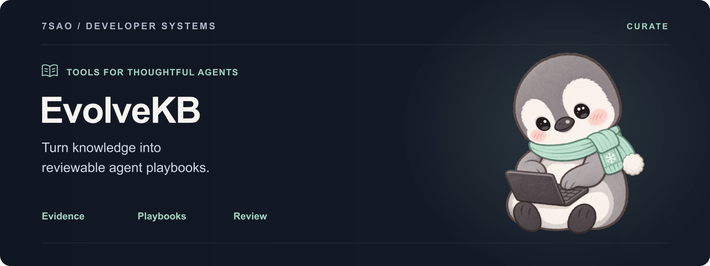
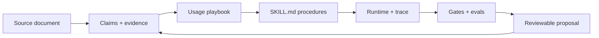
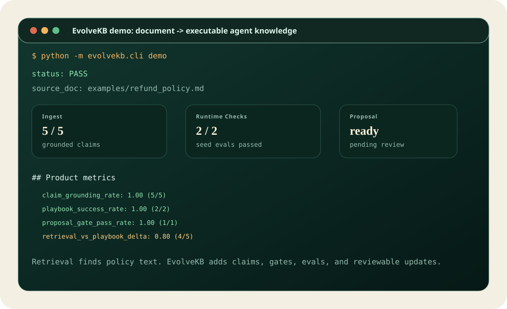

# EvolveKB

**Turn documents into evidence-backed playbooks that agents can execute, test, and update through review.**

<p align="center">
  <a href="./README.zh.md">简体中文</a> ·
  <a href="#quick-start">Quick start</a> ·
  <a href="#documentation">Docs</a> ·
  <a href="./docs/maintenance.md">Roadmap</a>
</p>

<p align="center">
  <a href="https://github.com/2sao7sao/EvolveKB/actions/workflows/ci.yml"></a>
  <a href="./pyproject.toml"></a>
  <a href="./pyproject.toml"></a>
  <a href="./LICENSE"></a>
</p>

## Why EvolveKB

Use EvolveKB when a policy, SOP, or runbook needs to drive repeatable agent behavior.
Retrieval supplies evidence; a playbook decides how to apply it. Knowledge changes
become proposals with review metadata and rollback paths.

| Capability | Inspect the implementation and scope |
| --- | --- |
| Compile documents into claims with source evidence | [Refund policy demo](examples/evolution_loop.md); deterministic extraction for the supplied examples. |
| Execute procedures and retain a step trace | [Support agent walkthrough](examples/customer_support_refund_agent.md) and [RunTrace contract](docs/RUNTIME_TRACE.md). |
| Swap evidence retrieval behind one contract | [EvidencePack and retrievers](docs/RETRIEVAL.md): local keyword, BM25, semantic-lite, hybrid, TF-IDF, and regex. |
| Review changes and check regressions | [Proposal impact and rollback](docs/PROPOSAL_REVIEW.md), [eval definitions](evals/), and [metric formulas](docs/METRICS.md). |

This is a local prototype with deterministic examples. Use a conventional search
stack for search-only needs; broader retrieval quality and production agent
performance are outside the current evidence.

## Quick start

Requires Python 3.11+. The demo uses synthetic data and needs no API key.

```bash
git clone https://github.com/2sao7sao/EvolveKB.git
cd EvolveKB
python -m venv .venv
source .venv/bin/activate
python -m pip install -e ".[dev]"
python -m evolvekb.cli demo
```

On Windows, activate the environment with `.venv\Scripts\activate`.
The demo runs in a temporary workspace and removes it afterward. It ingests a
refund policy, creates a pending proposal, runs gates and evals, and prints metrics.
For a concrete workflow, run `python examples/customer_support_refund_agent.py`.

## How it works



The runtime supports Python procedure entrypoints. Legacy `PROC_IMPL` procedures
remain as a compatibility fallback; the migration is not complete. Proposals and
rollback currently operate on local files. See the [maintenance plan](docs/maintenance.md).

## Reproduce the example



*This static illustration summarizes CLI output; it is not a live screenshot.
[Asset provenance and refresh instructions](docs/assets/README.md).*

The synthetic demo returned these values on 2026-11-16:

| Metric | Result | Meaning |
| --- | --- | --- |
| Claim grounding | 5/5 | Extracted claims retain source evidence quotes. |
| Playbook evals | 2/2 | The demo's routing and retrieval seeds pass. |
| Proposal gate | 1/1 | The demo proposal passes its evaluated gate. |
| Capability coverage delta | 4/5 (0.80) | Added coverage on a named five-item checklist. |

The delta measures **seed capability coverage**, not answer quality, retrieval
superiority, or a broad benchmark score. [Definitions and denominators](docs/METRICS.md).

Reproduce the broader repository checks:

```bash
python -m pytest -q
python -m evolvekb.cli validate --settings settings/evolve.yaml
python -m evolvekb.cli eval run "evals/*.yaml"
```

On 2026-11-16, the baseline `28af622` passed **97 tests** and **12 eval seeds**
locally on Python 3.12.6. Validation of the clean checkout reported
`no gates evaluated`: no generated claims or proposals were present to scan.
These results cover local fixtures; they do not establish production or external-agent acceptance.

## Status and next steps

The source package is version `0.4.0`, the first tagged release (2026-11-18); the
2026-11-16 review found no releases or tags. Several features previously listed under future v0.4–v0.6
roadmap headings already have prototype implementations.

| Area | Current state | Next acceptance step |
| --- | --- | --- |
| Retrieval and traces | EvidencePack, registered retrievers, and step traces implemented | Extend failure-case evals beyond the current seeds. |
| Procedure execution | Python entrypoints implemented; legacy fallback remains | Inventory remaining callers and prove migration compatibility. |
| Proposal review | Impact metadata, rollback plan, and local gates implemented | Add a rollback edge case and inspect its resulting artifacts. |
| Documentation and release | Runnable examples; tagged release `v0.4.0`; Pages site live | Keep entrypoints current; the site republishes from `docs/` on every main push. |

See [dated verification and actionable roadmap](docs/maintenance.md).
The hosted walkthrough is available at [2sao7sao.github.io/EvolveKB](https://2sao7sao.github.io/EvolveKB/);
the repository copy of `docs/index.html` is its source and is republished on every
push to `main`.

## Documentation

| Start here | Purpose |
| --- | --- |
| [Flagship demo](examples/evolution_loop.md) / [support agent](examples/customer_support_refund_agent.md) | Follow a concrete end-to-end example. |
| [Retrieval contract](docs/RETRIEVAL.md) / [runtime trace](docs/RUNTIME_TRACE.md) | Integrate evidence and execution tracing. |
| [Proposal review](docs/PROPOSAL_REVIEW.md) / [metrics](docs/METRICS.md) | Understand review gates and the limits of reported results. |
| [Skill template](docs/SKILL_TEMPLATE.md) / [starter tasks](docs/STARTER_ISSUES.md) | Add one scoped procedure, example, or eval. |
| [Maintenance](docs/maintenance.md) / [changelog](CHANGELOG.md) | Separate implemented foundations from remaining work. |

Source map: `evolvekb/` contains the runtime; `kb/` contains knowledge and usage
assets; `skills/` contains procedures; `settings/` contains presets; `evals/` and
`tests/` contain checks. The [retrieval guide](docs/RETRIEVAL.md) includes query
commands, and the [support example](examples/customer_support_refund_agent.md)
shows harness integration.

## Contributing and related projects

Read [CONTRIBUTING.md](CONTRIBUTING.md), choose a scoped item from the
[maintenance plan](docs/maintenance.md), and run the checks above. Keep private
documents, credentials, and customer traces out of examples and artifacts;
see [SECURITY.md](SECURITY.md).

Related projects: [EvolveMemory](https://github.com/2sao7sao/EvolveMemory) for agent
memory, [Agent Peak Bench](https://github.com/2sao7sao/agent-peak-bench) for agent
evaluation, and [Video Analysis Skills](https://github.com/2sao7sao/video-analysis-skills)
for video analysis workflows.

Licensed under [Apache-2.0](LICENSE).
