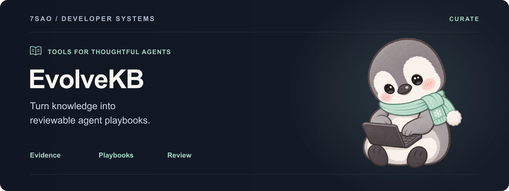
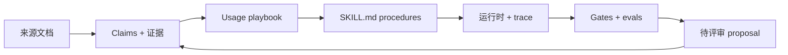
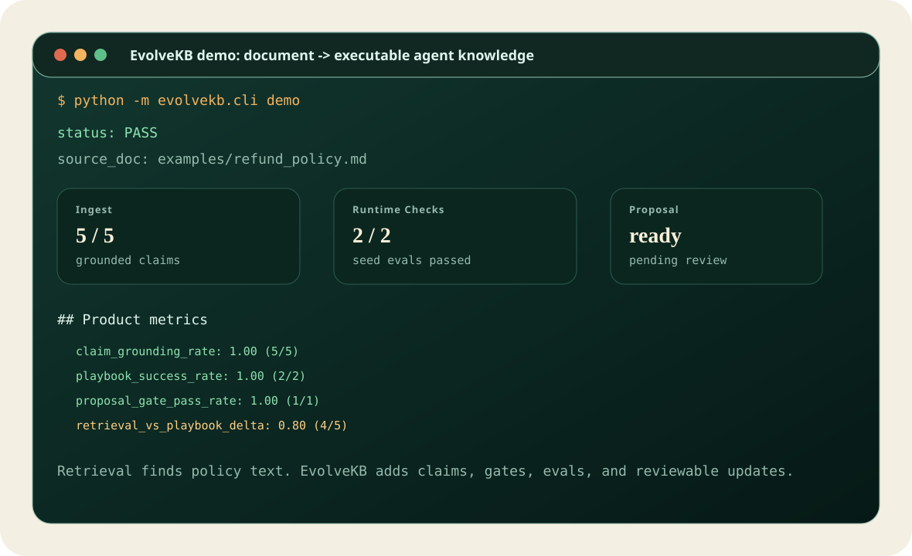

# EvolveKB

**把文档变成带证据的 playbook，让 Agent 能够执行、测试，并通过评审更新知识。**

<p align="center">
  <a href="./README.md">English</a> ·
  <a href="#快速开始">快速开始</a> ·
  <a href="#文档">文档</a> ·
  <a href="./docs/maintenance.md">路线与进展</a>
</p>

<p align="center">
  <a href="https://github.com/2sao7sao/EvolveKB/actions/workflows/ci.yml"></a>
  <a href="./pyproject.toml"></a>
  <a href="./pyproject.toml"></a>
  <a href="./LICENSE"></a>
</p>

## 为什么使用 EvolveKB

当政策、SOP 或 runbook 需要驱动可重复的 Agent 行为时，可以使用 EvolveKB。
检索层提供证据，playbook 决定如何使用证据；知识变更形成带评审信息和回滚路径的 proposal。

| 能力 | 实现证据与范围 |
| --- | --- |
| 把文档编译为带来源证据的 claims | [退款政策 Demo](examples/evolution_loop.md)；确定性抽取，覆盖仓库提供的示例。 |
| 执行 procedure 并记录步骤 trace | [客服 Agent 示例](examples/customer_support_refund_agent.md) 与 [RunTrace 契约](docs/RUNTIME_TRACE.md)。 |
| 在统一契约下替换检索方式 | [EvidencePack 与检索器](docs/RETRIEVAL.md)：本地 keyword、BM25、semantic-lite、hybrid、TF-IDF、regex。 |
| 评审变更并检查回归 | [Proposal 影响与回滚](docs/PROPOSAL_REVIEW.md)、[eval 定义](evals/) 和 [指标公式](docs/METRICS.md)。 |

项目目前是带确定性示例的本地原型。纯搜索需求适合使用专门的搜索方案；
现有证据尚不覆盖广泛检索质量或生产环境中的 Agent 效果。

## 快速开始

需要 Python 3.11+。Demo 使用合成数据，无需 API key。

```bash
git clone https://github.com/2sao7sao/EvolveKB.git
cd EvolveKB
python -m venv .venv
source .venv/bin/activate
python -m pip install -e ".[dev]"
python -m evolvekb.cli demo
```

Windows 使用 `.venv\Scripts\activate` 激活环境。
Demo 在临时 workspace 中运行，结束后清理该目录：摄取退款政策、生成待评审 proposal、
执行 gates 和 evals，最后输出指标。具体业务示例可运行
`python examples/customer_support_refund_agent.py`。

## 工作流程



运行时已支持 Python procedure entrypoint。旧 `PROC_IMPL` 仍作为兼容回退存在，迁移尚未完成。
Proposal 和 rollback 当前作用于本地文件。详见[维护计划](docs/maintenance.md)。

## 可复现示例



*这是根据 CLI 输出绘制的静态示意图，不是实时终端截图。
[素材来源与刷新方法](docs/assets/README.md)。*

2026-11-16 运行合成 Demo 得到：

| 指标 | 结果 | 含义 |
| --- | --- | --- |
| Claim grounding | 5/5 | 抽取的 claims 保留来源证据引用。 |
| Playbook evals | 2/2 | Demo 的路由和检索种子用例通过。 |
| Proposal gate | 1/1 | Demo proposal 通过实际执行的 gate。 |
| Capability coverage delta | 4/5（0.80） | 在明确列出的五项能力 checklist 上增加的覆盖。 |

Delta 衡量的是**种子用例的能力覆盖**，不代表答案质量、检索优势或广泛 benchmark 分数。
[定义与分母说明](docs/METRICS.md)。

复现仓库的其他检查：

```bash
python -m pytest -q
python -m evolvekb.cli validate --settings settings/evolve.yaml
python -m evolvekb.cli eval run "evals/*.yaml"
```

2026-11-16 在 Python 3.12.6 上复验基线 `28af622`：**97 个测试、12 个 eval 种子用例通过**。
干净 checkout 的 validate 明确输出 `no gates evaluated`，因为没有生成的 claims 或 proposals 可扫描。
这些结果验证本地 fixtures，不构成生产环境或外部 Agent 的验收结论。

## 当前状态与下一步

源码包版本为 `0.3.0`；2026-11-16 检查时没有 GitHub Release。
旧 roadmap 中归入未来 v0.4–v0.6 的多项能力，已经有原型实现。

| 方向 | 当前状态 | 下一项验收 |
| --- | --- | --- |
| 检索与 trace | 已有 EvidencePack、可注册检索器、步骤 trace | 在现有种子外增加失败场景评估。 |
| Procedure 执行 | 已有 Python entrypoint；保留旧 fallback | 盘点剩余调用方并验证迁移兼容性。 |
| Proposal 评审 | 已有影响信息、回滚计划和本地 gates | 增加回滚边界用例并检查生成产物。 |
| 文档与发布 | 示例可运行；源码版本 0.3.0 | 维护可用入口，单独决定 Release 与可选 Pages 发布。 |

详见[带日期的验证记录和待办](docs/maintenance.md)。
目前通过仓库内的 walkthrough 阅读文档；本次检查未发现可用的 GitHub Pages 站点。

## 文档

| 入口 | 用途 |
| --- | --- |
| [核心 Demo](examples/evolution_loop.md) / [客服 Agent](examples/customer_support_refund_agent.md) | 跟随具体端到端示例。 |
| [检索契约](docs/RETRIEVAL.md) / [运行时 trace](docs/RUNTIME_TRACE.md) | 接入证据与执行追踪。 |
| [Proposal 评审](docs/PROPOSAL_REVIEW.md) / [指标](docs/METRICS.md) | 理解评审 gates 与结果边界。 |
| [Skill 模板](docs/SKILL_TEMPLATE.md) / [入门任务](docs/STARTER_ISSUES.md) | 增加一个范围明确的 procedure、示例或 eval。 |
| [维护计划](docs/maintenance.md) / [变更记录](CHANGELOG.md) | 区分已实现基础与待完成工作。 |

源码结构：`evolvekb/` 是运行时，`kb/` 是知识与 usage assets，`skills/` 是 procedures，
`settings/` 是预设，`evals/` 和 `tests/` 是检查。[检索指南](docs/RETRIEVAL.md)包含查询命令，
[客服示例](examples/customer_support_refund_agent.md)包含 harness 接入方式。

## 贡献与相关项目

阅读[贡献指南](CONTRIBUTING.md)，从[维护计划](docs/maintenance.md)选择范围明确的任务，
并运行上面的检查。示例和产物不要包含私有文档、凭据或客户 trace；
详见[安全说明](SECURITY.md)。

相关项目：[EvolveMemory](https://github.com/2sao7sao/EvolveMemory) 关注 Agent 记忆，
[Agent Peak Bench](https://github.com/2sao7sao/agent-peak-bench) 关注 Agent 评估，
[Video Analysis Skills](https://github.com/2sao7sao/video-analysis-skills) 提供视频分析工作流。

许可证：[Apache-2.0](LICENSE)。
